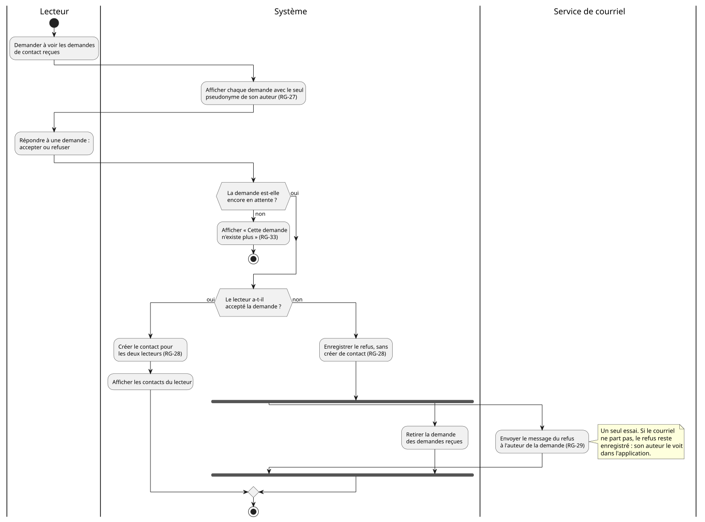

# Diagramme d'activité — Book Shelf

> Version 0.1 du 17/11/2026 · Auteur : Alex · Statut : brouillon
>
> Sources : [cas d'utilisation v0.1 du 17/11/2026](cas-utilisation.md) · [exigences v0.2 du 17/11/2026](exigences.md)

## 1. Pourquoi ce cas

Le cas dessiné est « Répondre à une demande de contact » ([sa description](cas-utilisation.md#répondre-à-une-demande-de-contact)). C'est celui dont le déroulement se ramifie le plus :

- trois acteurs y agissent : le lecteur, le système et le service de courriel ;
- il contient deux décisions (la demande est-elle encore en attente ? le lecteur l'a-t-il acceptée ?) et un parallélisme (le courriel du refus) ;
- l'action d'un lecteur y change quelque chose pour un autre : le contact vaut pour les deux (RG-28), et le refus est annoncé à l'auteur de la demande (RG-29).

« Ajouter un livre » a autant de décisions, mais un seul passage de relais, entre le lecteur et le système : sa description suffit.

## 2. Diagramme

Source : [diagrammes/activite-repondre-demande-contact.puml](diagrammes/activite-repondre-demande-contact.puml).

## 3. Lecture

Le lecteur demande à voir ses demandes reçues ; le système n'en montre que le pseudonyme de l'auteur (RG-27). Quand le lecteur répond, une première décision vérifie que la demande est encore en attente : sinon, il voit « Cette demande n'existe plus » et rien n'est enregistré (RG-33). Une seconde décision suit sa réponse : acceptée, la demande crée un contact pour les deux lecteurs ; refusée, elle n'en crée aucun (RG-28). Après un refus, deux actions se font en parallèle : le service de courriel envoie le message à l'auteur de la demande (RG-29), pendant que le système met à jour la liste du lecteur, qui n'attend donc pas le courriel.

## 4. Ce que le diagramme a révélé

| Découverte | Décision | Reportée dans |
| --- | --- | --- |
| Une décision manquait : entre l'affichage et la réponse, la demande peut disparaître (compte de son auteur supprimé, réponse déjà donnée dans une autre fenêtre) | Le lecteur voit « Cette demande n'existe plus » et rien n'est enregistré ; les demandes en attente sont supprimées avec le compte | [exigences.md](exigences.md), RG-33 ; [cas-utilisation.md](cas-utilisation.md), exception E3 et critère à ajouter à US-22 |
| Le relais vers le service de courriel peut échouer, et rien ne disait si le système réessaie | Un seul essai : le refus reste enregistré et son auteur le voit dans l'application | [cas-utilisation.md](cas-utilisation.md), exception E1 |
