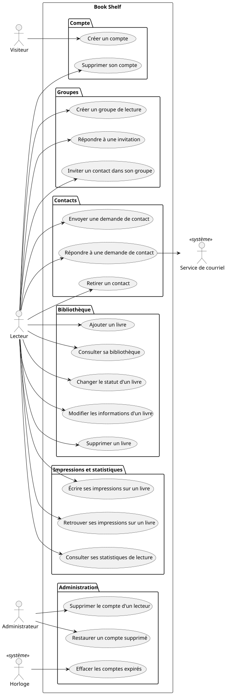

# Cas d'utilisation — Book Shelf

> Version 0.1 du 17/11/2026 · Auteur : Alex · Statut : brouillon
>
> Sources : [exigences v0.2 du 17/11/2026](exigences.md) · [note de cadrage v0.3 du 17/11/2026](../note-de-cadrage.md) · [backlog v0.2 du 16/11/2026](../backlog.md)

## 1. Acteurs

Un acteur est un rôle, pas une personne : la même personne est « visiteur » tant qu'elle n'a pas de compte, « lecteur » ensuite.

| Acteur | Type | Ce qu'il attend du système |
| --- | --- | --- |
| Visiteur | Humain, principal | Créer un compte (EX-01) |
| Lecteur | Humain, principal | Se connecter (EX-02) ; tenir sa bibliothèque (EX-03 à EX-05, EX-10, EX-11) ; enregistrer et retrouver ses impressions (EX-06, EX-07) ; consulter ses statistiques (EX-08) ; supprimer son compte (EX-09) ; ajouter et retirer des contacts (EX-20, EX-21, EX-24) ; créer un groupe, y inviter ses contacts, rejoindre un groupe sur invitation (EX-14, EX-15, EX-22) |
| Administrateur | Humain, principal | Supprimer le compte d'un lecteur (EX-12) ; restaurer un compte supprimé (EX-13) |
| Horloge | Système, principal | Déclencher l'effacement définitif des comptes supprimés depuis 30 jours (RG-16) et la suppression des comptes sans connexion depuis 2 ans (ENF-02) |
| Service de courriel | Système externe, secondaire | Recevoir le message à envoyer : le refus d'une demande de contact (RG-29) |

## 2. Diagramme

Source : [diagrammes/cas-utilisation.puml](diagrammes/cas-utilisation.puml).

## 3. Choix de modélisation

- **Périmètre** : seules les exigences Must et Should sont dessinées. Les Could (EX-16 à EX-19, EX-23) n'y figurent pas, ni le service externe de données de livres, que seule la vitrine (EX-23) utilise.
- **« Se connecter » (EX-02)** n'est pas un cas : ce n'est pas un but en soi, c'est une précondition des cas du lecteur et de l'administrateur.
- **Le créateur d'un groupe** n'est pas un acteur : le même lecteur est créateur d'un groupe et simple membre d'un autre. Être le créateur est une précondition de « Inviter un contact dans son groupe » (RG-31).
- **Aucune généralisation** entre acteurs : le lecteur ne crée pas de compte, il n'hérite donc pas du visiteur ; aucune exigence ne dit que l'administrateur fait ce que fait un lecteur.
- **Aucun `include` ni `extend`** : un cas qui dépend d'un autre (restaurer un compte supprimé, inviter un contact) le dit en précondition ; ce qui ne se produit que parfois (le courriel après un refus, RG-29) est écrit dans la description du cas.
- **« Quitter un groupe »** n'est pas un cas : un membre ne quitte un groupe que si le contact avec son créateur est retiré (RG-30). C'est un résultat de « Retirer un contact ».
- **« Effacer les comptes expirés »** réunit deux délais : 30 jours après une suppression par l'administrateur (RG-16) et 2 ans sans connexion (ENF-02). Un seul cas, car la raison et le résultat sont les mêmes.
- **Six paquets** : avec 19 cas, le diagramme dépasse la quinzaine au-delà de laquelle il se lit mal. Les cas sont regroupés selon les épopées du backlog, dans un seul diagramme.

## 4. Description des cas principaux

Les cas décrits en entier sont ceux qui portent le plus de règles de gestion.

### Ajouter un livre

| Rubrique | Contenu |
| --- | --- |
| Acteur principal | Lecteur |
| Acteurs secondaires | Aucun |
| Objectif | Garder la trace d'un livre dans sa bibliothèque, avec son statut |
| Exigences | EX-03 ; RG-04, RG-05, RG-06, RG-13 ; ENF-04, ENF-05 |
| Préconditions | Le lecteur est connecté |
| Postconditions (succès) | Le livre figure une seule fois dans la bibliothèque du lecteur, avec ses informations et son statut |
| Postconditions (échec) | Rien n'est enregistré ; le lecteur sait pourquoi |

**Scénario nominal** :

1. Le lecteur demande à ajouter un livre.
2. Le système demande le titre, l'auteur, le genre, l'année de publication, la langue d'origine et la langue de lecture, et propose le statut à choisir : « à lire » (par défaut), « en cours » ou « lu » (RG-05).
3. Le lecteur renseigne ces informations, choisit un statut et demande l'ajout.
4. Le système vérifie que le titre est renseigné (RG-04), que l'année de publication est valide et que le livre n'est pas déjà dans la bibliothèque du lecteur (RG-13).
5. Le système enregistre le livre dans la bibliothèque du lecteur.
6. Le système affiche la bibliothèque, où le livre apparaît avec son statut.

**Scénarios alternatifs** :

- A1 — Livre déjà présent, autre langue de lecture (étape 4) : le système reconnaît le livre à son titre et à son auteur ; il ajoute la langue de lecture au livre existant, sans créer de second livre (RG-13). Le scénario reprend à l'étape 6.
- A2 — Statut « lu » choisi (étape 3) : le système enregistre aussi la date de fin de lecture, la date du jour, que le lecteur peut modifier (RG-06).

**Exceptions** :

- E1 — Titre absent (étape 4) : le système affiche « Le titre est obligatoire » ; rien n'est enregistré (RG-04).
- E2 — Année de publication non valide (étape 4) : le système affiche « L'année de publication doit être une année, par exemple 1942 » ; rien n'est enregistré (ENF-04).
- E3 — Livre déjà présent dans la même langue de lecture (étape 4) : le système affiche « Ce livre est déjà dans votre bibliothèque » ; rien n'est enregistré (RG-13).
- E4 — Enregistrement impossible (étape 5) : le système affiche « Le livre n'a pas pu être ajouté. Réessayez dans un instant », sans texte technique ; rien n'est enregistré (ENF-04).

### Répondre à une demande de contact

| Rubrique | Contenu |
| --- | --- |
| Acteur principal | Lecteur (celui qui a reçu la demande) |
| Acteurs secondaires | Service de courriel |
| Objectif | Décider si l'auteur de la demande devient un de ses contacts |
| Exigences | EX-21 ; RG-27, RG-28, RG-29, RG-33 ; ENF-02, ENF-04 |
| Préconditions | Le lecteur est connecté ; il a reçu une demande de contact, restée sans réponse |
| Postconditions (succès) | Demande acceptée : chacun des deux lecteurs figure dans les contacts de l'autre. Demande refusée : aucun contact n'est créé et l'auteur de la demande en est informé par courriel |
| Postconditions (échec) | Rien n'est enregistré ; le lecteur sait pourquoi |

**Scénario nominal** :

1. Le lecteur demande à voir les demandes de contact qu'il a reçues.
2. Le système affiche chaque demande avec le pseudonyme de son auteur, et rien d'autre sur lui (RG-27).
3. Le lecteur accepte une demande.
4. Le système vérifie que la demande est encore en attente (RG-33).
5. Le système crée le contact, qui vaut pour les deux lecteurs (RG-28).
6. Le système affiche les contacts du lecteur, où figure le pseudonyme de l'auteur de la demande.

**Scénarios alternatifs** :

- A1 — Demande refusée (étape 3) : le lecteur refuse la demande ; le système ne crée aucun contact (RG-28), enregistre le refus et confie au service de courriel le message qui en informe l'auteur de la demande (RG-29, ENF-02). La demande ne figure plus parmi les demandes reçues.

**Exceptions** :

- E1 — Courriel non envoyé (A1) : le système ne fait qu'un essai ; le refus reste enregistré et le lecteur ne voit aucune erreur ; l'auteur de la demande voit le refus parmi ses demandes envoyées (RG-29).
- E2 — Enregistrement impossible (étape 5 ou A1) : le système affiche « Votre réponse n'a pas pu être enregistrée. Réessayez dans un instant », sans texte technique ; la demande reste sans réponse (ENF-04).
- E3 — Demande qui n'est plus en attente (étape 4) : le système affiche « Cette demande n'existe plus » ; rien n'est enregistré (RG-33).

## 5. Des cas d'utilisation aux user stories

Chaque cas est rapproché des user stories du [backlog](../backlog.md) ; « — » signifie qu'il n'y a pas d'écart.

| Cas d'utilisation | User stories | Écart et décision |
| --- | --- | --- |
| Créer un compte | US-01 | — |
| Supprimer son compte | US-09 | — |
| Ajouter un livre | US-03 | US-03 n'a pas de critère pour deux chemins de la description : le statut « lu » choisi à l'ajout (A2) et la même langue de lecture, refusée (E3). Deux critères à ajouter à US-03 |
| Consulter sa bibliothèque | US-04 | — |
| Changer le statut d'un livre | US-05 | — |
| Modifier les informations d'un livre | US-10 | — |
| Supprimer un livre | US-10 | — |
| Écrire ses impressions sur un livre | US-06 | — |
| Retrouver ses impressions sur un livre | US-07 | — |
| Consulter ses statistiques de lecture | US-08 | — |
| Supprimer le compte d'un lecteur | US-11 | — |
| Restaurer un compte supprimé | US-11 | — |
| Effacer les comptes expirés | US-11, US-09 | Aucune story ne prévoit ce cas. Pas de nouvelle story : un critère à ajouter à US-11 (effacement après 30 jours) et un à US-09 (suppression après 2 ans sans connexion) |
| Créer un groupe de lecture | US-12 | — |
| Répondre à une invitation | US-13 | — |
| Inviter un contact dans son groupe | US-23 | — |
| Envoyer une demande de contact | US-22 | — |
| Répondre à une demande de contact | US-22 | US-22 n'a pas de critère pour le courriel envoyé après un refus (A1), ni pour le refus qui reste valable si le courriel n'est pas envoyé (E1), ni pour la demande qui n'est plus en attente (E3). Deux critères à ajouter à US-22 |
| Retirer un contact | US-22 | — |

Stories sans cas d'utilisation, par décision ([§ 3](#3-choix-de-modélisation)) : US-02 est une précondition ; US-14, US-15, US-16, US-20 et US-21 sont des Could, non dessinés ; US-17 à US-19 sont hors périmètre.

Les exceptions techniques (saisie non valide, enregistrement impossible) ne deviennent pas des critères : la [définition de « terminé », § 3](../definition-of-done.md#3-sécurité-rgpd-et-accessibilité) les couvre pour toutes les stories.
