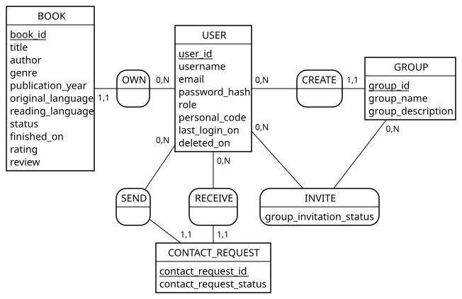

# Modèle conceptuel des données — Book Shelf

> Version 0.1 du 18/11/2026 · Auteur : Alex · Statut : brouillon
>
> Sources : [exigences v0.4 du 18/11/2026](exigences.md) · [cas d'utilisation v0.2 du 18/11/2026](cas-utilisation.md)

## 1. Dictionnaire des données

Les données des exigences « Must » et « Should ». Les codes sont en anglais, comme le code de l'application. AN : alphanumérique ; N : numérique.

| Code | Signification | Type | Taille | Remarque |
| --- | --- | --- | --- | --- |
| user_id | Identifiant d'un compte | N | | Identifiant |
| username | Pseudonyme : nom affiché du lecteur | AN | | Obligatoire (EX-01) |
| email | Adresse de courriel du compte | AN | 254 | Obligatoire, unique (RG-01) |
| password_hash | Empreinte du mot de passe | AN | | Obligatoire (ENF-01) |
| role | Rôle du compte : lecteur ou administrateur | AN | | Obligatoire (RG-17) |
| personal_code | Code à donner pour recevoir une demande de contact | AN | | Unique (RG-26) |
| last_login_on | Date de la dernière connexion | Date | | Compte supprimé après 2 ans sans connexion (ENF-02) |
| deleted_on | Date de suppression par l'administrateur | Date | | Vide si le compte est actif (RG-16) |
| book_id | Identifiant d'un livre | N | | Identifiant |
| title | Titre du livre | AN | | Obligatoire (RG-04) |
| author | Nom de l'auteur | AN | | Sert à reconnaître un même livre (RG-13) |
| genre | Genre du livre | AN | | |
| publication_year | Année de publication | N | | Une année, par exemple 1942 |
| original_language | Langue dans laquelle le livre a été écrit | AN | | |
| reading_language | Langue dans laquelle le lecteur lit le livre | AN | | Sert à reconnaître un même livre (RG-13) |
| status | Statut du livre : « à lire », « en cours » ou « lu » | AN | | « à lire » par défaut (RG-05) |
| finished_on | Date de fin de lecture | Date | | Remplie quand le statut passe à « lu » (RG-06) |
| rating | Note donnée au livre | N | | De 1 à 10 (RG-07) ; privée (RG-08) |
| review | Texte du lecteur sur le livre : ressenti et citations | AN | | Un seul par livre ; privé (RG-08) |
| contact_request_id | Identifiant d'une demande de contact | N | | Identifiant |
| contact_request_status | Statut d'une demande de contact : « en attente », « acceptée » ou « refusée » | AN | | Contact créé à l'acceptation (RG-28) |
| group_id | Identifiant d'un groupe | N | | Identifiant |
| group_name | Nom du groupe de lecture | AN | | Obligatoire (EX-14), unique (RG-18) |
| group_description | Description du groupe | AN | | |
| group_invitation_status | Statut d'une invitation dans un groupe : « en attente », « acceptée » ou « refusée » | AN | | Entrée dans le groupe à l'acceptation (RG-21) |

**Données écartées** :

| Donnée | Raison |
| --- | --- |
| Mot de passe | Jamais enregistré : seule son empreinte l'est (ENF-01) |
| Date d'effacement définitif | Calculée : `deleted_on` plus 30 jours (RG-16) |
| Compte inactif | Calculée : `last_login_on` date de plus de 2 ans (ENF-02) |
| Année de lecture | Calculée : année de `finished_on` (RG-11) |
| Nombre de livres lus | Calculé : compte des livres au statut « lu » (RG-10, RG-12) |
| Nombre de demandes de contact à un même lecteur | Calculé : compte des demandes envoyées (RG-29) |
| Liste des contacts d'un lecteur | Calculée : ses demandes au statut « acceptée » (RG-28) |
| Liste des membres d'un groupe | Calculée : son créateur et les invités au statut « acceptée » (RG-19, RG-21) |
| Livre du groupe, objectif de rythme, chapitres lus | Exigences « Could » (EX-18, EX-19) : hors de ce modèle |

## 2. Entités, associations et cardinalités

| Entité | Identifiant | Propriétés |
| --- | --- | --- |
| USER | user_id | username, email, password_hash, role, personal_code, last_login_on, deleted_on |
| BOOK | book_id | title, author, genre, publication_year, original_language, reading_language, status, finished_on, rating, review |
| GROUP | group_id | group_name, group_description |
| CONTACT_REQUEST | contact_request_id | contact_request_status |

| Association | Entités et cardinalités | Lecture | Règle qui fixe la cardinalité |
| --- | --- | --- | --- |
| OWN | USER 0,n — 1,1 BOOK | Un utilisateur possède zéro ou plusieurs livres ; un livre appartient à un seul utilisateur | 0,n : bibliothèque vide possible (EX-04) ; 1,1 : RG-14 |
| SEND | USER 0,n — 1,1 CONTACT_REQUEST | Un utilisateur envoie zéro ou plusieurs demandes ; une demande est envoyée par un seul utilisateur | 0,n : EX-20 ; 1,1 : RG-33 |
| RECEIVE | USER 0,n — 1,1 CONTACT_REQUEST | Un utilisateur reçoit zéro ou plusieurs demandes ; une demande est reçue par un seul utilisateur | 0,n : EX-20 ; 1,1 : RG-33 |
| CREATE | USER 0,n — 1,1 GROUP | Un utilisateur crée zéro ou plusieurs groupes ; un groupe est créé par un seul utilisateur | 0,n : RG-19 ; 1,1 : EX-14, RG-35 |
| INVITE | USER 0,n — 0,n GROUP ; porte `group_invitation_status` | Un utilisateur est invité dans zéro ou plusieurs groupes ; un groupe invite zéro ou plusieurs utilisateurs | 0,n : EX-22 ; une seule invitation par utilisateur et par groupe : RG-20 |

**Choix discutables** :

- Une seule entité BOOK, sans entité pour les lectures : le même livre lu dans une autre langue est un autre livre (RG-13).
- `author`, `genre` et les deux langues sont du texte, pas des entités : aucune liste à tenir.
- Une seule entité USER, avec `role` : tous les comptes se connectent de la même façon.
- Identifiants abstraits : un courriel, un titre et un nom de groupe peuvent changer.
- CONTACT_REQUEST est une entité : jusqu'à 3 demandes entre les mêmes lecteurs (RG-29).
- Un contact n'est pas une entité : c'est une demande au statut « acceptée » (RG-28).
- INVITE est une association, pas une entité : une seule invitation par utilisateur et par groupe.

## 3. Schéma

Représentation textuelle : la source Mocodo, [diagrammes/mcd.mcd](diagrammes/mcd.mcd).

## 4. Vérifications

- **Première forme normale** : chaque propriété a une seule valeur. `review` est un seul texte (EX-06) ; un livre a une seule langue de lecture (RG-13).
- **Deuxième forme normale** : seule INVITE a un identifiant composé, l'utilisateur et le groupe ; `group_invitation_status` dépend des deux.
- **Troisième forme normale** : aucune propriété ne dépend d'une autre propriété. Un livre lu dans une autre langue a son propre titre : c'est un autre livre, sans répétition (RG-13).

**Écrans « Must »** : chacun trouve ses données en partant de l'utilisateur connecté.

| Écran | Données | Chemin |
| --- | --- | --- |
| Création de compte, Connexion, Mon compte | username, email, password_hash, last_login_on | USER |
| Bibliothèque | title, author, original_language, reading_language, status | USER, OWN, BOOK |
| Ajout d'un livre, Fiche d'un livre | Les dix propriétés du livre | USER, OWN, BOOK |
| Statistiques | status, finished_on, author, genre | USER, OWN, BOOK |

**Ce que le modèle ne garantit pas** : ces règles seront du code et des tests.

- Au plus 3 demandes de contact au même lecteur (RG-29), et aucune à soi-même (RG-34).
- Les unicités hors identifiant : courriel (RG-01), code personnel (RG-26), nom de groupe (RG-18), livre en double (RG-13).
- Les valeurs permises : les trois statuts (RG-05), la note de 1 à 10 (RG-07) ; une date de fin seulement pour un livre « lu » (RG-06).
- Les invitations : seul le créateur invite, et seulement ses contacts (RG-31) ; un contact retiré fait quitter le groupe (RG-30).
- Les délais : effacement après 30 jours (RG-16), suppression après 2 ans sans connexion (ENF-02).
- Qui voit quoi : chacun ne voit que ses livres et ses impressions (RG-08, RG-14).
- Deux écritures d'un même auteur ou d'un même genre comptent pour deux dans les statistiques.
